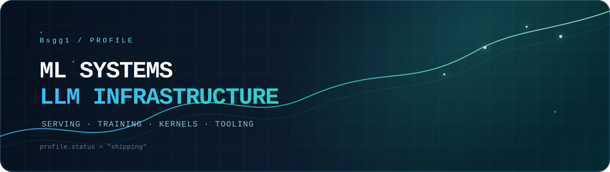

<div align="center">



<br />

[GitHub](https://github.com/Bsgg1) · [Repositories](https://github.com/Bsgg1?tab=repositories) · [Activity](https://github.com/Bsgg1?tab=activity)

</div>

## Hello, I'm Bsgg1

I work on the systems underneath modern AI: **high-throughput inference, RL post-training, GPU kernels, and reliable training infrastructure**.

Currently, I'm an ML infrastructure engineer at [Mind Lab](https://macaron.im/mindlab), turning ambitious research ideas into systems that can actually run, scale, and be debugged.

```text
profile.status = "shipping"
profile.interests = ["LLM serving", "RL infrastructure", "GPU kernels", "developer tools"]
profile.tools = ["Python", "CUDA", "Triton", "PyTorch", "Rust", "C++", "Linux"]
```

## What I'm building

| Area | What it means in practice |
| --- | --- |
| **LLM systems** | Serving, scheduling, memory, and performance work around vLLM and SGLang |
| **RL infrastructure** | Training and post-training systems with hardware-aware execution |
| **GPU kernels** | Triton/CUDA kernels where every microsecond matters |
| **Engineering tools** | Small, sharp tools that make research workflows easier to operate |

<div align="center">

<sub>Measure twice. Profile once. Ship often.</sub>

</div>
